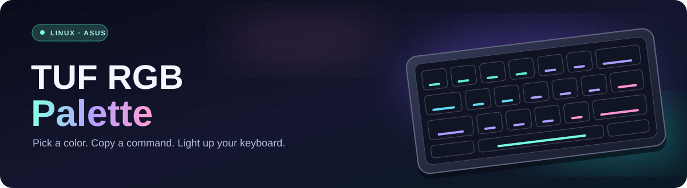

<p align="center">
  
</p>

<h3 align="center">Choose your glow. One click, one command. ✨</h3>

<p align="center">
  A tiny, beautiful, offline-friendly RGB color picker for ASUS TUF keyboards on Linux.<br />
  <strong>32 colors · Custom HEX picker · Zsh aliases · No dependencies · No firmware saving</strong>
</p>

<p align="center">
  <a href="https://fatemeh-mohseni-ai.github.io/tuf-rgb-palette/"></a>
  <a href="https://github.com/fatemeh-mohseni-AI/tuf-rgb-palette/blob/main/keyboard-colors.zsh"></a>
  <a href="LICENSE"></a>
</p>

<p align="center">
  <a href="https://fatemeh-mohseni-ai.github.io/tuf-rgb-palette/"><strong>🌈 Try the web app</strong></a>
  &nbsp;·&nbsp;
  <a href="#-quick-start"><strong>⚡ Quick start</strong></a>
  &nbsp;·&nbsp;
  <a href="#-color-collection"><strong>🎨 Browse colors</strong></a>
</p>

---

## 💡 What is TUF RGB Palette?

A lightweight color palette that turns a colorful swatch into a **ready-to-paste Linux terminal command**. No Armoury Crate, daemon, or extra RGB driver installation is required **when your laptop already exposes the compatible kernel interface**.

Built around an **ASUS TUF Gaming F15 FX507ZM** running **Ubuntu 22.04 with Linux kernel 6.8**. It may work on other ASUS TUF devices with the same `asus-wmi` sysfs interface; those models are not verified here.

> [!IMPORTANT]
> The website **only copies commands to your clipboard**; it cannot directly control your keyboard. Run the copied command on a compatible Linux machine. Every provided command uses the **temporary** setting, not the firmware-save setting.

## ✨ Highlights

| | Feature | What it does |
|:--:|---|---|
| 🎨 | **32 hand-picked shades** | Warm, green, blue, purple, pink & neutral |
| 🖱️ | **One-click copy** | Click a swatch to copy the full Linux command |
| 🌈 | **Custom color picker** | Choose any HEX color and generate an RGB command |
| 🔎 | **Search & filters** | Find colors by name, group, HEX or alias |
| ⌨️ | **Zsh shortcuts** | Type `kb-mint`, `kb-purple`, `kb-ice` and more |
| 📴 | **Offline by design** | Open `index.html` directly; no packages or build step |
| 💾 | **No firmware save** | RGB changes are requested for the current session only |

## 🚀 Quick start

**Option A — use the website**

### [🌐 Open the interactive palette](https://fatemeh-mohseni-ai.github.io/tuf-rgb-palette/)

Pick a color → click to copy → paste into your terminal. That's it.

**Option B — run it completely offline**

```bash
git clone https://github.com/fatemeh-mohseni-AI/tuf-rgb-palette.git
cd tuf-rgb-palette
xdg-open index.html
```

The page uses plain HTML, CSS and JavaScript; no external images, scripts, fonts, trackers or network requests are needed to use the color picker. If a browser blocks automatic copying from a local `file://` page, the app provides a manual copy fallback.

### 🐚 Optional: install the Zsh shortcuts

Clone the repository **inside your home directory**, then add its helper script to Zsh:

```zsh
cd "$HOME"
git clone https://github.com/fatemeh-mohseni-AI/tuf-rgb-palette.git
echo 'source "$HOME/tuf-rgb-palette/keyboard-colors.zsh"' >> ~/.zshrc
source ~/.zshrc
```

Now use any of the aliases:

```zsh
kb-mint        # fresh teal-green
kb-purple      # violet glow
kb-ice         # icy blue
kb-rose        # rosy pink
kb-warmwhite   # warm white
kb-off         # request static black (0, 0, 0)
```

Or pick any custom RGB combination (0–255 per channel):

```zsh
kbd_rgb 0 211 184
```

> Already cloned elsewhere? Edit the `source` path in `~/.zshrc` to point to your actual copy of `keyboard-colors.zsh`. Add the line only once.

## 🎨 Color collection

Here are a few favorites from the **32 built-in presets**:

| Shade | HEX | Zsh command | Mood |
|---|---|---|---|
| 🟢 Mint | `#00D3B8` | `kb-mint` | Cool & fresh |
| 🟣 Purple | `#A032FF` | `kb-purple` | Dreamy |
| 🔵 Sky | `#50A0FF` | `kb-sky` | Soft blue |
| 🩵 Ice | `#A0DCFF` | `kb-ice` | Frosted |
| 🩷 Rose | `#FF4682` | `kb-rose` | Warm pink |
| 🟠 Amber | `#FFBF00` | `kb-amber` | Golden hour |
| 🟢 Emerald | `#00C878` | `kb-emerald` | Bright green |
| ⚪ Warm White | `#FFE0B9` | `kb-warmwhite` | Cozy desk |

<details>
<summary><strong>See all 32 Zsh aliases</strong></summary>

| Family | Aliases |
|---|---|
| 🔴 **Warm** | `kb-red` · `kb-crimson` · `kb-coral` · `kb-orange` · `kb-amber` · `kb-gold` · `kb-yellow` |
| 🟢 **Green** | `kb-lime` · `kb-green` · `kb-emerald` · `kb-mint` · `kb-teal` · `kb-turquoise` |
| 🔵 **Blue** | `kb-cyan` · `kb-ice` · `kb-sky` · `kb-blue` · `kb-royal` · `kb-navy` |
| 🟣 **Purple** | `kb-lavender` · `kb-purple` · `kb-violet` · `kb-magenta` · `kb-fuchsia` |
| 🩷 **Pink** | `kb-pink` · `kb-hotpink` · `kb-rose` · `kb-peach` |
| ⚪ **Neutral** | `kb-white` · `kb-warmwhite` · `kb-cream` · `kb-off` |

</details>

Actual LED colors may look different from a monitor swatch. `kb-off` sends RGB (0, 0, 0); the visual result depends on the keyboard firmware.

## 🛠️ How it works

If your laptop has the supported interface, the website generates a command like this:

```bash
# Mint / static RGB / temporary (not stored in firmware)
printf '0 0 0 211 184 0\n' | sudo tee /sys/class/leds/asus::kbd_backlight/kbd_rgb_mode
```

The six values are `command mode red green blue speed`:

| Part | Value | Purpose |
|---|---|---|
| Command | `0` | Apply temporarily; don't ask firmware to save |
| Mode | `0` | Static color |
| RGB | `0 211 184` | Red, green and blue (0–255) |
| Speed | `0` | Not relevant for static mode |

The color may reset after restarting, sleeping, or changing power states, depending on your hardware. `sudo` may prompt for your password when writing to the sysfs interface.

### ✅ Check compatibility

```bash
uname -r
ls /sys/class/leds/asus::kbd_backlight/kbd_rgb_mode
```

If that path is missing, this project won't work as-is: it does **not** install or modify kernel drivers. Do not substitute unverified sysfs paths or arbitrary values.

## 📁 Project structure

```text
tuf-rgb-palette/
├── assets/
│   └── hero.svg            # README banner
├── index.html              # Offline-friendly interactive palette
├── keyboard-colors.zsh     # 32 aliases + custom RGB function
├── README.md               # This guide
└── LICENSE                 # MIT
```

## 🤝 Contributing

Have another compatible ASUS model, a favorite RGB shade, or a UI improvement? Issues and pull requests are welcome. If you add or edit presets, please keep the colors in `index.html` and `keyboard-colors.zsh` in sync.

## 📄 License

[MIT](LICENSE) · Built with 💜 for Linux & colorful keyboards.

<p align="center"><a href="https://fatemeh-mohseni-ai.github.io/tuf-rgb-palette/"><strong>🌈 Open the palette and find your glow</strong></a></p>
